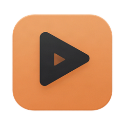

  

<h1 align="center">ClipForge AI — downloads</h1>

  Turn long videos (streams, let's plays, podcasts) into short vertical clips with subtitles, titles and hashtags. 
  Runs on your own computer. Nothing is uploaded or published automatically.

  <a href="../../releases/latest"><b>⬇ Download the latest version</b></a>
  &nbsp;·&nbsp;
  <a href="#install-on-mac">Mac install steps</a>
  &nbsp;·&nbsp;
  <a href="#install-on-windows">Windows install steps</a>

---

## Download

| Your computer | File to download | Size |
|---|---|---|
| **Mac** with Apple Silicon (M1 or newer), macOS 12 or later | `ClipForge-AI_<version>_aarch64.dmg` | about 410 MB |
| **Windows** 10 or 11, 64-bit | `ClipForge-AI_<version>_x64-setup.exe` | about 190 MB |

Both files are on the **[latest release page](../../releases/latest)**, under **Assets**. Ignore the other files there (`.sig`, `.tar.gz`, `latest.json`); the app uses them for updates.

**Using Windows? [Jump to the Windows steps ↓](#install-on-windows)**

## Install on Mac

1. **Download** the `.dmg` file from the [latest release](../../releases/latest).
2. **Open** it and drag **ClipForge AI** onto the **Applications** folder.
3. **Open ClipForge AI** from Applications. The first time, macOS says it can't be opened, because the app isn't signed with a paid Apple certificate yet. Click **Done**.
4. **Allow it once:** open **System Settings → Privacy & Security**, scroll down, click **Open Anyway** next to ClipForge AI, and confirm with your password or Touch ID.
5. **Follow the setup** that opens (about 2 minutes plus downloads). It asks before downloading the speech model (1.5 GB).

Intel Macs are not supported.

## Install on Windows

1. **Download** the `-setup.exe` file from the [latest release](../../releases/latest).
2. **Double-click** it.
3. If a blue box says **"Windows protected your PC"**, click **More info**, then **Run anyway**. It appears because the app isn't signed with a paid certificate yet.
4. **Click through the installer.** It installs for your user only and doesn't ask for administrator rights.
5. **Open ClipForge AI** from the Start menu and follow the setup. It asks before downloading the speech model.

No graphics card is needed; ClipForge uses the processor if there is no suitable one (slower).

> **Windows status:** the installer is built and tested automatically on a virtual Windows PC (it installs, starts, renders and transcribes, and uninstalls cleanly). **It has not been tried by a person on a real Windows PC yet.** If you try it, please report what you see (see [Problems](#problems)).

## One more step: the AI that picks the moments

ClipForge needs one of these to choose the clips. The setup and **Settings** show both.

| Option | Cost | What you do | Privacy |
|---|---|---|---|
| **Ollama** (local, recommended) | Free | Install Ollama from [ollama.com/download](https://ollama.com/download), then press **Download** next to the AI model in ClipForge (about 3.3 GB). | Everything stays on your computer. |
| **Google Gemini** (cloud) | Free tier, rate limited | Get a key at [aistudio.google.com](https://aistudio.google.com) → **Get API key** and paste it in **Settings**. | The **text** of what is said in your videos is sent to Google. Video and audio stay on your computer. |

Gemini is faster, and on unscripted commentary it picked better moments in one rated test. Local is the default because nothing leaves your computer.

## Make your first clips

1. **New project** → choose a video file, drop it onto the window, or paste a link.
2. Pick the clip length, number of clips and subtitle style, then **Create and start processing**. Start with a 5–20 minute video.
3. Open a clip to change its start and end, framing, subtitles or title, then **Save & re-render**.
4. **Export.** Each clip gets a `.txt` file next to it with its title, description and hashtags.

ClipForge suggests and scores moments. It cannot predict or promise that a clip will go viral. You review every clip before posting.

## Updates

ClipForge checks for new versions by itself and **asks** before downloading or installing anything. Your projects, videos, settings and AI models are kept, and are backed up before each update.

## Features

- **Finds moments** from what is said, with a 0–100 score, the reason each moment was picked, and title, description and hashtags.
- **Clean endings:** clips end when the sentence is finished, and keep a loud reaction (a scream or laugh) after the last word instead of cutting it off.
- **No repeats:** clips that say almost the same thing are removed, even far apart in the video.
- **Webcam layout:** a streamer's webcam in a corner is found automatically and shown above the gameplay.
- **Subtitles:** four styles including **Punch** (one big word at a time, yellow highlight); every word can be corrected.
- **Vertical 1080×1920** with loudness levelled for phones; crop or blurred-background framing.
- **Cancel and resume** at any time; finished steps are never repeated.
- **Your files are safe:** original videos are never changed or deleted by the app.

---

## Where your files are

| What | Mac | Windows |
|---|---|---|
| Videos, clips, exports | `~/Movies/ClipForge AI` (changeable) | `Videos\ClipForge AI` (changeable) |
| Projects, settings, AI models | `~/Library/Application Support/ClipForge AI` | `%LOCALAPPDATA%\ClipForge AI Data` |
| Logs | `~/Library/Logs/ClipForge AI` | `%LOCALAPPDATA%\ClipForge AI Data\logs` |

Uninstalling the app or updating it never deletes these folders.

## Checking a download

`SHA256SUMS.txt` on the release page lists each file's checksum. Mac: `shasum -a 256 <file>`. Windows (PowerShell): `Get-FileHash <file>`.

## Problems

[Open an issue](../../issues/new) here. Please say what you did, what happened, your system and the app version (shown on the **Components** page), and attach a screenshot and the log files if you can. **Do not paste API keys or personal information: issues here are public.**

This repository holds only the installers and update files; there is no source code here.
